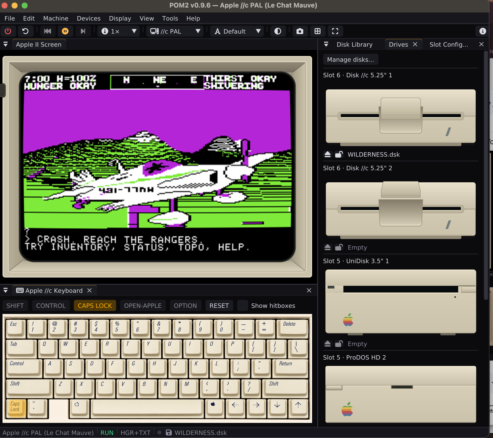

<div align="center">

# 🍏 POM2 v0.9.7 — Apple II Emulator

### A floppy disk. A glowing screen. One more game.

Play, explore and create on the Apple II — on your desktop or in your browser.
Nine machine profiles, from the original Apple ][ to the //c Plus.

[](https://github.com/habib256/pom2/releases/latest)
[](https://habib256.github.io/pom2/wasm/)



Linux · macOS · Windows · Raspberry Pi · WebAssembly · GPL-3.0

</div>

**[Start playing](#start-playing) · [Why POM2?](#why-pom2) ·
[Bundled disks](#bundled-disks) · [Build it](#build-it)**

> **v0.9.7:** [What's new](docs/releases/v0.9.7.md) ·
> [Downloads and checksums](https://github.com/habib256/pom2/releases/latest)

## Start playing

**In a browser:** [launch POM2](https://habib256.github.io/pom2/wasm/).
It opens a PAL Apple //c with the DIX-fix demo disk. The browser build follows
`main`, so it may differ from a tagged release.

**On your computer:** [download a package](https://github.com/habib256/pom2/releases/latest),
unpack it and launch POM2. Firmware, fonts and artwork are included. Keep the
executable and its accompanying folders together.

| Platform | Package |
|---|---|
| Linux x86-64 | `POM2-v<version>-x86_64.AppImage` |
| Linux ARM64 desktop | `POM2-v<version>-aarch64.AppImage` |
| Raspberry Pi 3–5 | `POM2-v<version>-raspberry-aarch64.AppImage` |
| Raspberry Pi 4 / Pi 400 | `POM2-v<version>-pi400-aarch64.AppImage` |
| macOS 10.15+ | `POM2-macOS-v<version>.dmg` — Intel and Apple Silicon |
| Windows 10/11 x64 | `POM2-Windows-v<version>.zip` |
| Self-hosted browser | `POM2-v<version>-web-wasm.zip` |

On Linux, make the AppImage executable before opening it:

```bash
chmod +x POM2-v0.9.7-x86_64.AppImage
./POM2-v0.9.7-x86_64.AppImage
```

Then pick a machine in **Machine → Profile**, drop a disk image onto the
window, and play. POM2 accepts `.dsk`, `.do`, `.d13`, `.po`, `.nib`, `.woz`,
`.moof`, `.2mg` and `.hdv`. You can also open **File → Disk Library** to try
one of the included disks.

New to the Apple II? At the BASIC prompt, type `PRINT "HELLO, APPLE II!"`
and press Return.

## Why POM2?

- **Find your Apple II.** Nine profiles cover the ][, ][+, //e, //c and //c+
  families, including PAL variants. Choose the machine your software expects.
- **Feel the machine.** Cycle-aware video, CRT and RGB display choices, drive
  sounds, the speaker and expansion-card audio bring games and demos to life.
- **Explore your collection.** Drag disks into the drive rack, browse images,
  use protected WOZ/FLUX media and mount supported 3.5-inch MOOF disks.
- **Keep going.** Rewind recent execution or save a supported machine and its
  read-only disks in a `.pom2session` file.
- **Go further.** Configure cards, use a gamepad, print with ImageWriter II,
  inspect memory and debug 6502 code. Kiosk mode fills the screen for play.

For the machine list, hardware details, disk-write behavior, shortcuts and
advanced setup, see the [user guide](docs/USER-GUIDE.md).

## Bundled disks

Four disks are ready in **File → Disk Library**:

| Disk | Try it for |
|---|---|
| [A2 File Cmd XL v0.9.8](https://github.com/habib256/a2filecmd/releases/tag/v0.9.8) | A ProDOS file manager on a 32 MB hard-disk image; mount in an HDV/SmartPort bay. |
| [DIX-fix](https://github.com/Fr3nchT0uch/DIX/) | French Touch demos; use a PAL //e with Mockingboard in slot 4. |
| [ChromaBreak 1.0](https://github.com/habib256/pom2games/releases/tag/chromabreak-1.0) | A colourful brick-breaking game. |
| [Micro-Sokoban 1.2](https://github.com/habib256/pom2games/releases/tag/1.2) | A small puzzle with many crates to move. |

[Disk setup and sources](packaging/disks/README.txt) ·
[SHA-256 checksums](packaging/disks/SHA256SUMS.txt)

## Handy controls

| Key | Action |
|---|---|
| **F6** (hold) | Rewind |
| **F10** | Toggle fullscreen |
| **F9** | Save a screenshot |
| **F11 / F12** | Soft reset / power cycle |
| **Ctrl+Shift+P** | Open the command palette |
| **Ctrl+V** | Paste text into the Apple II |

In fullscreen, **F1** opens the game menu and **F2** opens the on-screen
keyboard. The [user guide](docs/USER-GUIDE.md#controls) has the full list.

## Build it

On Linux or macOS, install Git, CMake, a C++17 compiler and GLFW, then:

```bash
git clone https://github.com/habib256/pom2.git
cd pom2
./setup_imgui.sh
cmake -S . -B build -DCMAKE_BUILD_TYPE=Release
cmake --build build --parallel 3
./build/POM2
```

[Windows, Raspberry Pi and WebAssembly instructions](docs/USER-GUIDE.md#build-from-source) ·
[Tests and contributing](CONTRIBUTING.md) ·
[Third-party notices](THIRD-PARTY.md)
