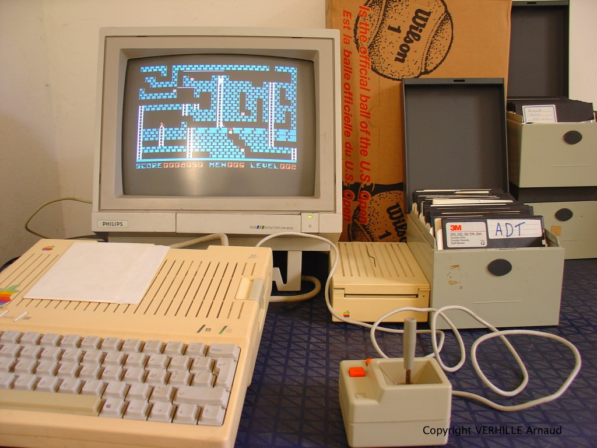

<div align="center">

# 🍏 POM2 v0.9.6 — Apple II Emulator

### A floppy disk. A glowing screen. One more game.

The Apple II is still alive. People still write games for it, make demos,
share disks and find new tricks in its old chips. POM2 brings that world to
your computer — or straight into your browser.

**Play an old favourite. Discover something new. Type a little BASIC.**

[](https://github.com/habib256/pom2/releases/latest)
[](https://habib256.github.io/pom2/wasm/)



*An Apple //c, a box of floppies, a joystick within reach. Photo: Arnaud Verhille.*

Linux · macOS · Windows · Raspberry Pi · WebAssembly<br>
Nine Apple II profiles · GPL-3.0

</div>

**[Get started](#get-started) · [Disks to discover](#disks-to-discover) ·
[Make it yours](#make-it-yours) · [Controls](#controls) ·
[Build from source](#build-from-source)**

> **v0.9.6:** see the [release notes](docs/releases/v0.9.6.md) for the changes
> and the [releases page](https://github.com/habib256/pom2/releases/latest)
> for downloads and checksums.

## Get started

**The quickest way:** [open POM2 in your browser](https://habib256.github.io/pom2/wasm/).
The online build follows `main`, so it may differ from a tagged release.

**On your computer:** download a package from the
[releases page](https://github.com/habib256/pom2/releases/latest), unpack it,
and launch POM2. Firmware, fonts and interface artwork come with the package.
Keep the executable and its accompanying folders together.

| Your computer | Package to choose |
|---|---|
| Linux, Intel or AMD 64-bit | `POM2-v<version>-x86_64.AppImage` — glibc 2.27+ |
| Linux, ARM64 desktop or server | `POM2-v<version>-aarch64.AppImage` — desktop OpenGL, glibc 2.39+ |
| Raspberry Pi 3, 4 or 5 | `POM2-v<version>-raspberry-aarch64.AppImage` — OpenGL ES 3.0, glibc 2.36+ |
| Raspberry Pi 4 or Pi 400 | `POM2-v<version>-pi400-aarch64.AppImage` — optimised for these machines |
| macOS 10.15+ | `POM2-macOS-v<version>.dmg` — Intel and Apple Silicon |
| Windows 10/11, 64-bit | `POM2-Windows-v<version>.zip` |
| Your own web server | `POM2-v<version>-web-wasm.zip` |

The Pi 400 package targets the Cortex-A72 in the Pi 4 and Pi 400. Choose the
regular Raspberry Pi package for a Pi 3 or Pi 5.

<details>
<summary>First launch on Linux, macOS or Windows</summary>

**Linux / Raspberry Pi:** make the downloaded AppImage executable, then open it.
For example, with the x86_64 package:

```bash
chmod +x POM2-v0.9.6-x86_64.AppImage
./POM2-v0.9.6-x86_64.AppImage
```

Use the actual filename of the version you downloaded. If FUSE is unavailable,
add `--appimage-extract-and-run` when launching the AppImage.

**macOS:** open the DMG and drag POM2 into Applications. The app is ad-hoc signed;
macOS may ask you to allow it through **System Settings → Privacy & Security →
Open Anyway** after the first launch attempt. See
[Apple's instructions](https://support.apple.com/en-us/102445).

**Windows:** extract the ZIP and open `POM2.exe`. If SmartScreen blocks the
unsigned app, **More info → Run anyway** lets you launch it.

Release downloads include `SHA256SUMS.txt` for checking file integrity.

</details>

### Your first disk

1. **Choose a machine** in **Machine → Profile**. The first-launch default is
   an Apple //e Enhanced PAL; a //c is a lovely place to start, too.
2. **Drop a disk image onto the window.** POM2 mounts it and boots it. You can
   also browse images through **File → Disk Library**.
3. **Play.** Use the keyboard or a connected gamepad. Press **F10** for a
   fullscreen view; press it again to return to the desktop interface.

Disk images can be `.dsk`, `.do`, `.d13`, `.po`, `.nib`, `.woz`, `.2mg` or
`.hdv`. A game written for a particular Apple II still needs that machine:
changing profiles performs a cold reset.


The default desktop places the **Apple II Screen** with its Monitor II frame
above the **Apple Keyboard** on the left. The right column groups **Drives**
(selected), **Disk Library** and **Slot Configuration** as tabs. The keyboard
skin follows the active machine; saved window arrangements are restored on
later launches. The screenshot shows Ultima V on //c PAL; the game and machine
selection belong to that session.

No disk handy? At the Applesoft prompt, try this:

```basic
10 HOME
20 PRINT "HELLO, APPLE II!"
30 FOR I = 1 TO 10
40 PRINT "ONE MORE GAME..."
50 NEXT I
RUN
```

That blinking prompt still has room for your next idea.

## Disks to discover

Four disks join the **v0.9.6 packages**. Open the Disk Library to find them
alongside your own images. They're a small invitation to explore what people
are still making for the Apple II.

| Disk | What's inside | Start with |
|---|---|---|
| **[A2FC XL v0.9.6](https://github.com/habib256/a2filecmd/releases/tag/v0.9.6)** | A2FileCommander on a 32 MB ProDOS volume | Mount in an HDV / SmartPort hard-disk bay, then boot its slot. The bundled 6502 edition also supports II/II+. |
| **[DIX-fix](https://github.com/Fr3nchT0uch/DIX/)** | French Touch's demo anthology, with POM2's menu patch | //e PAL, 128 KB; Mockingboard in slot 4 and SmartPort / Liron in slot 5. Return or Space starts the automatic sequence from the fresh menu. |
| **[ChromaBreak 1.0](https://github.com/habib256/pom2games/releases/tag/chromabreak-1.0)** | Colourful brick-breaking | //e Enhanced or //c, 128 KB; boot as a 5¼-inch disk. |
| **[Micro-Sokoban 1.2](https://github.com/habib256/pom2games/releases/tag/1.2)** | Crates, corners and “just one more puzzle” | II+ or later; boot as a 5¼-inch disk. |

The images live in `bundled_disks/` in packages. Their
[README](packaging/disks/README.txt) records the setup and source of each disk;
[checksums](packaging/disks/SHA256SUMS.txt) identify the original shipped files.
The browser's default boot image is DIX-fix.

Your own disk collections stay yours: release packages exclude the local
`disks_5.4/`, `disks_3.5/` and `hdv/` libraries.

## Make it yours

### The glow of the screen

Choose composite colour, crisp RGB, white, green or amber phosphor. In
**Display → CRT Settings**, adjust the curve, persistence and screen effects
until it feels like the monitor you remember. **Display → Monitor II frame**
adds the familiar case around the picture.

POM2 follows video changes as the emulated CPU makes them. That matters for
split-screen games and demos that change modes while the beam crosses the
screen. Monochrome keeps the Apple II's fine light-and-dark dot patterns,
including the dotted appearance behind orange and blue hi-res colours.

For a different perspective, open the **3D voxel view** from Display and orbit
the running picture. The old pixels have a little depth now.

### The chatter of the drive

Open **Devices → Storage → Drives** for a vertical stack of your configured
drives. Slot cards appear from slot 7 down to slot 1,
with each card's drives in numerical order. This matches the //e's slot scan;
the //c normally tries its internal 5.25-inch drive, then SmartPort, without
automatically trying the external 5.25-inch drive. The //c+ keeps its internal and
external 3.5-inch mechanisms at the top. Click an empty drive picture to choose an image, or drop a file onto
it from your desktop or the Disk Library. POM2 inserts it into that drive
without restarting your game. Eject a mounted disk before inserting another.
The file browser lets you explore your whole disk: jump to Home, the root or
mounted volumes, enter a folder path directly, and reveal hidden folders.
The doors, activity lights and mounted disk names follow the machine.

The Audio Mixer's **Automatic** sound mode uses **MAME recordings for classic
Disk II drives** and **Virtual II recordings for //c-family 5¼-inch drives**
when you've supplied them. Without those recordings, it uses MAME. Automatic
mode keeps MAME sounds for 3½-inch drives; manual bank selection is available.

<details>
<summary>Use your own Virtual II recordings</summary>

In **Audio Mixer**, choose **Import sounds...**, enter your sound-folder path,
and click **Validate and use**. Restart POM2 to activate the recordings.

Required files, relative to that folder:

```text
lecteur/Disk Rotation.wav
lecteur/Move arm.aiff
lecteur/Disk Insertion.aiff
lecteur/Disk Removal.aiff
```

WAV alternatives to the AIFF files are accepted. The dialog lists missing or
unreadable files. Optional sounds include those under `interface/` and
`imprimante/Matrix Printer.wav`.

POM2 reads your recordings in place. They are user-supplied and are excluded
from release packages.

</details>

### One more chance

Hold **F6** to rewind, or open **Rewind (time-travel)** to move back through
recent execution and resume. Snapshots let you save and reload a machine state.

Disk saves and external devices have their own history: rewind cannot undo a
write already saved to disk or an action performed by a connected FujiNet.

### Joysticks, keys and paper

Mapped gamepads use the left stick for `PDL(0/1)` and the right stick for
`PDL(2/3)`. The Joystick panel has deadzone, square-gate and axis-inversion
controls. Unmapped desktop joysticks use their raw X/Y axes and leave the extra
paddles centred.

With a **SNES MAX** card installed, the first two mapped gamepads feed its
two SNES ports (D-pad, four face buttons, Select/Start and shoulder buttons).
They stop driving the Apple game port and keyboard shortcuts. Use **F1/F2**
for kiosk controls: the pads' Start/Select now belong to the guest.

The clickable **Apple Keyboard** selects the //c photo for //c, //c PAL and
//c+ machines, and the //e photo for other profiles. Both skins use the same
2578 × 908 image dimensions, with their own clickable key positions. It lets
you type with the mouse and latch Shift, Control and the Apple keys (Option
on the //c). It is also handy for sending guest Ctrl+V,
which the host keyboard normally uses for clipboard paste.

And yes, you can print. Open **Devices → ImageWriter II (printout)**, connect
a printer interface, and watch the dots appear on the page. The printer handles
text, graphics and colour, with PNG and multi-page PDF export.

## Controls

| Key or action | What it does |
|---|---|
| **Alt+Enter** / Alt+keypad Enter | Enter fullscreen with mouse capture; subsequent presses toggle capture while staying fullscreen |
| **F10** / **Ctrl+Alt+F** | Switch between fullscreen and the windowed interface |
| **Ctrl+Alt+G** / middle mouse button | Toggle mouse capture for an installed Mouse Card |
| **F6**, held | Rewind |
| **F9** | Save a screenshot |
| **F11** | Soft reset / Ctrl-Reset |
| **F12** | Hard reset / power-cycle |
| **Ctrl+Shift+P** | Open the command palette |
| **Ctrl+V** | Paste the host clipboard into the Apple II |
| Left / right Alt | Open-Apple / Solid-Apple, when enabled |
| Enter / Backspace / arrow keys | Return / left arrow / Apple II arrows |
| Ctrl+A…Z | Apple II control characters; Ctrl+V is intercepted for paste |

A Mouse Card normally belongs in **slot 4** on a //e: slot 3's internal
80-column firmware can hide it from guest software. **View → Capture mouse**
also controls capture. Switching away from POM2 releases the pointer; clicks
on POM2 menus and panels stay with the interface.

### Fullscreen evenings

Fullscreen is POM2's **kiosk mode**: the Apple II picture fills the view,
without the desktop panels. Switching views leaves the emulated machine running.

In kiosk mode, **F1 / gamepad Start** opens the game menu; **F2 / Select** opens
the on-screen keyboard. Navigate with arrows or the D-pad, confirm with
Enter / A, and go back with Esc / B. The menu can restart a game, browse disk
folders or return to the windowed interface. **Alt+F4** quits.

```bash
POM2 --kiosk "my-game.dsk"
```

Kiosk sessions leave your saved settings and window layout alone. Disk images
can still receive game saves.

## Choose your Apple II

From the original ][ to the //c Plus, choose a profile in **Machine → Profile**.
NTSC profiles run at about 60 Hz; PAL profiles at about 50 Hz. Pick the machine
and timing your software expects, especially for demos.

| Machine | CPU | CLI preset |
|---|---|---|
| Apple ][ (1977) | 6502 | `ii` |
| Apple ][+ (1979) | 6502 | `ii+` |
| Apple //e Unenhanced (1983) | 6502 | `iie-u` |
| Apple //e Enhanced (1985) | 65C02 | `iie` |
| Apple //c (1984) | 65C02 | `iic` |
| Apple //c Plus (1988) | 65C02 | `iic+` |
| Apple //e Unenhanced PAL | 6502 | `iie-u-pal` / `frenchtouch` |
| Apple //e Enhanced PAL — first-launch default | 65C02 | `iie-pal` |
| Apple //c PAL — Le Chat Mauve | 65C02 | `iic-pal` / `chatmauve` |

The default //e Enhanced PAL has Grappler+ in slot 1, Mockingboard in slot 2,
Mouse Card in slot 4, SmartPort in slot 5, Disk II in slot 6 and Le Chat Mauve
in slot 7. Slot 3 is empty; extended 80-column memory uses the AUX connector.

On IIe profiles, a storage card in slot 3 cannot boot through its slot entry
after reset: the motherboard's 80-column firmware owns that ROM page. Use
another slot. The //c family forces its built-in devices, including SmartPort
in slot 5 and the 5¼-inch controller in slot 6, over saved expansion choices.
The //c+ adds its physical Sony drives; //c PAL also forces its RGB adapter.

**Machine → Slot Configuration** lets you change cards and mount or boot disks.
For CFFA3000 storage, choose `cffa3` in a free slot (usually slot 7) and
assign images to its eight SmartPort bays. To use its floppy role, configure
Disk II in another slot (usually slot 6) and mount the floppy image there.
The CFFA3000's CF/USB file browser and automatic virtual-slot assignment
are not emulated. Floppy Emu remains a separate device with its own panel.
Some programs expect specific slots: DIX, for example, needs its Mockingboard
moved to slot 4. The //c family's built-in devices are locked to their hardware
positions. Profile changes reset the machine and remount disks where possible.
An absent or unreadable main ROM refuses a profile change and keeps the
current machine and its configuration.

At power-on, the supplied ROMs choose boot devices in this order:

| Machine | Automatic boot |
|---|---|
| Original Apple II | No disk autostart in the original ROM |
| II+ / unenhanced IIe (NTSC or PAL) | Slots 7 → 1, requiring the older four-byte boot signature |
| Enhanced IIe (NTSC or PAL) | Slots 7 → 1; HDV cards qualify too |
| //c (NTSC or PAL, SmartPort-capable ROM) | Internal S6D1, then SmartPort S5; no automatic S6D2 attempt |
| //c+ | Internal Sony, connected external Sonys, external SmartPort, then first 5¼-inch drive |

The Drives window groups controllers and their drives; its row order is not
a per-drive boot sequence. **Insert + Boot** selects the mounted controller.
If its firmware cannot select the requested drive or unit, POM2 reports why;
on //c+, booting an external SmartPort image requires ejecting Sony disks first.

## Explore the hardware

POM2 uses MAME as a hardware reference, with regression tests for its CPU and
device behaviour. The interface leaves room to explore the cards that made
these machines so versatile.

| Area | Available hardware and tools |
|---|---|
| **Video** | Text, lo-res, hi-res, double hi-res and 80 columns; composite NTSC, AppleWin NTSC, monochrome, Video-7, Le Chat Mauve RGB and VidHD Super Hi-Res on a //e |
| **Memory** | Language Card, IIe auxiliary memory and RamWorks III up to 8 MB |
| **Sound** | Speaker, cassette, Mockingboard A/C, Mockingboard C with SSI263 speech, Phasor, Cricket / Echo; stereo mixing and mono output |
| **Storage** | Disk II, Sony 3½-inch mechanisms, SmartPort, Liron, ProDOS HDV, CFFA 2.0, CFFA3000 SmartPort HLE and Floppy Emu |
| **Input and printing** | Mouse Card, joysticks/paddles, 4play, SNES MAX, Super Serial, parallel interfaces and ImageWriter II |
| **Expansion** | Microsoft SoftCard Z80, TransWarp, Videx Videoterm, clocks and Apple II Workstation Card |
| **Connections** | Uthernet I/II, FujiNet relay, TNFS disk downloads and a ProDOS host-folder volume |
| **Creative tools** | HGR/DHGR Paint Editor, HGR Sprite Editor, screenshots and print exports |
| **Inspection** | Memory viewer, debugger with symbols, conditional breakpoints, step over/out, profiling and execution history; snapshots and an optional AI-control HTTP API |

For card keys, firmware details and implementation notes, see
[CLAUDE.md](CLAUDE.md) and [DEV.md](DEV.md).

<details>
<summary>Networking and a few hardware boundaries</summary>

- **Uthernet II:** TCP/UDP use host sockets on desktop Linux, macOS and Windows.
  With `uthernet_allow_loopback=true`, `LISTEN` accepts local TCP clients at
  `127.0.0.1` on the guest's chosen port (1024+; 1985/6502/6503 excluded).
  LAN listening/port forwarding is not implemented.
  Uthernet I and raw Ethernet modes require libslirp, included in the ARM64,
  Raspberry Pi and Pi 400 Linux packages. Source builds can enable it with
  `-DPOM2_ENABLE_SLIRP=ON` when the library is available.
- **FujiNet:** POM2 relays to a FujiNet desktop build or a physical USB board.
  It does not emulate the FujiNet itself. Use an II+ / //e profile; the relay
  normally occupies slot 7. See `POM2 --help` for connection options.
- **Workstation Card:** Apple's firmware boots and passes its diagnostics.
  A LocalTalk network and AppleShare netboot are not implemented.
- **//c and //c+:** SmartPort units are supported; the //c+ also boots through
  its internal Sony drive's IWM/MIG path. The UniDisk drive-side 65C02 firmware
  is represented by its protocol rather than emulated as another CPU.
- **Compatibility:** some protected games require older II/II+ hardware.
  Mouse positioning can drift in A2DeskTop / MGTK. Use the issue tracker for
  reproducible problems, including the image format and selected profile.

</details>

## Your disks and saves

Images are **writable by default**. Games can save scores and progress back to
them. Storage panels report pending, saving, saved or failed writes; disk writes
are saved automatically in the background.

Enable **Write-protected** in a media panel or Slot Configuration, or right-click
an image in the Disk Library. This changes the host file's write permissions;
WOZ/2IMG header protection also applies. For a protected collection by default,
launch with `POM2_MEDIA_WRITE_DEFAULT=protected`.

You can organise your own collection with these folders:

```text
bundled_disks/  The four disks selected for v0.9.6 packages
disks_5.4/     Your 5¼-inch images
disks_3.5/     Your 3½-inch images
hdv/          Your hard-disk images
floppyemu/    Floppy Emu media (created on first run)
roms/         System and peripheral firmware
```

Screenshots and printouts go into POM2's per-user data directory:

| System | Data directory |
|---|---|
| Linux | `~/.local/share/POM2/` (`XDG_DATA_HOME` is honoured) |
| macOS | `~/Library/Application Support/POM2/` |
| Windows | `%LOCALAPPDATA%\POM2\` |

Replacement ROMs can go in `roms/` under that directory. Firmware and other
third-party material have their own rights and notices; see
[THIRD-PARTY.md](THIRD-PARTY.md).

## Command line

```bash
POM2 "my-game.woz"                          # mount and boot
POM2 --preset iic "my-game.dsk"             # choose a machine
POM2 --kiosk "my-game.dsk"                  # fullscreen
POM2 tnfs://host/path/image.po              # fetch, cache and boot
POM2 --snapshot-save session.pom2snap
POM2 --snapshot-load session.pom2snap
POM2 --help                                # all options
```

Other options cover speed, display mode, cassette recording, blank disks,
ProDOS host folders, FujiNet and automation. Optional values use `=`:
`--ai-control=6503`, for example. CLI `--rewind` rewinds the **cassette**;
F6 and the Rewind panel control machine time-travel.

## Build from source

### Linux and macOS

You need Git, a C++17 compiler, CMake and GLFW. The setup script installs
platform dependencies and fetches the pinned Dear ImGui docking revision.

```bash
git clone https://github.com/habib256/pom2.git
cd pom2
./setup_imgui.sh
cmake -S . -B build -DCMAKE_BUILD_TYPE=Release
cmake --build build --parallel 3
./build/POM2
```

On Raspberry Pi, configure with `-DPOM2_GLES=ON` and install the GLES/EGL
development packages. See the [Raspberry Pi guide](packaging/raspberry/README.md)
for native builds and performance tuning.

<details>
<summary>Windows build</summary>

Install Visual Studio's C++ workload, CMake, Git and vcpkg. Fetch the same
Dear ImGui revision used by setup and CI; the pin lives in `imgui_pin.env`.
Run these commands in PowerShell from the repository root:

```powershell
git clone https://github.com/ocornut/imgui.git
$imguiPin = ((Get-Content imgui_pin.env | Where-Object { $_ -match '^IMGUI_COMMIT=' }) -split '=', 2)[1]
git -C imgui checkout $imguiPin
vcpkg install --triplet x64-windows-static
cmake -S . -B build "-DCMAKE_TOOLCHAIN_FILE=$env:VCPKG_INSTALLATION_ROOT/scripts/buildsystems/vcpkg.cmake" -DVCPKG_TARGET_TRIPLET=x64-windows-static
cmake --build build --config Release --parallel 3
```

The manifest supplies the dependencies. The static triplet matches the release
build's CRT and avoids shipping extra DLLs.

</details>

<details>
<summary>WebAssembly build</summary>

Activate an [Emscripten SDK](https://emscripten.org/docs/getting_started/downloads.html)
and populate `imgui/` with the pinned revision, then:

```bash
./build_wasm.sh
./build_wasm.sh --serve
```

The local server supplies the headers needed for browser threads. The asset
list comes from [the package manifest](packaging/bundle.manifest), including
the curated disks. `--with-data` adds the local `disks_3.5/` collection for
**development only**; do not publish that larger personal bundle.

The browser opens a PAL Apple //c and boots DIX-fix by default, with the
Apple II Screen docked on the left and Drives on the right. URL parameters
`?preset=...&disk=...` override the machine and boot image; `?nodisk=1`
starts without a disk.

Host socket networking and the listening AI-control HTTP server are unavailable
in the browser.

</details>

### Tests and packages

```bash
cmake -S . -B build -DPOM2_ENABLE_TESTS=ON
cmake --build build --parallel 3
ctest --test-dir build --parallel 2 --output-on-failure
```

[CONTRIBUTING.md](CONTRIBUTING.md) explains the test suite, source guards and
requirements for fixes. [docs/PERFORMANCE.md](docs/PERFORMANCE.md) covers
measurements and profiling.

Release notes live in `docs/releases/`. A version tag triggers the
[release workflow](.github/workflows/release.yml); a manual workflow run builds
artifacts without publishing a release. All platforms read the same
[package manifest](packaging/bundle.manifest).

Local packaging: `./build_dist.sh` on Linux, `./package_macos_release.sh` on macOS,
and `package_windows_release.bat` on Windows.

## Still making things

POM2 is for playing, exploring and creating. A new demo, a small puzzle game,
a BASIC listing passed to a friend — the Apple II still has places to go.

- **Arnaud Verhille** — POM2 and the photograph above.
- **MAME** — CPU and hardware references.
- **AppleWin, OpenEmulator and MicroM8** — video models, sequencing and inspiration
  for voxel viewing and rewind.
- **sscanf/apple2e-emulator** — MIT-licensed Monitor II / Disk II artwork;
  notices and editable sources are in [pic/retro/](pic/retro/).
- **French Touch and today's Apple II authors** — demos, games, tools and disks
  that keep these machines busy.
- **Steve Wozniak and Steve Jobs** — the Apple II that started it all.

Found a bug or have something to share? [Open an issue](https://github.com/habib256/pom2/issues).
For security reports, use [SECURITY.md](SECURITY.md).

POM2 is **GPL-3.0** — see [LICENSE](LICENSE). Third-party code, firmware,
fonts, sound samples and photographs are documented in
[THIRD-PARTY.md](THIRD-PARTY.md).

[Changelog](CHANGELOG.md) · [Developer guide](DEV.md) ·
[Project orientation](CLAUDE.md) · [Backlog](TODO.md)
