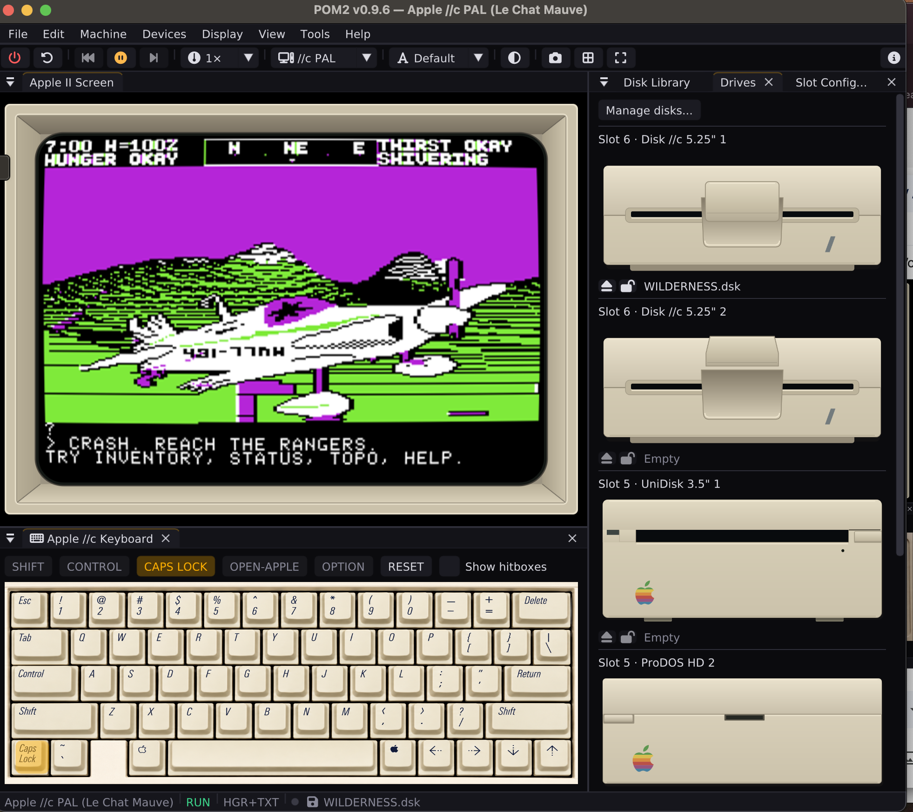

<div align="center">

# 🍏 POM2 v1.1.2 — Apple II Family Emulator

[](https://habib256.github.io/pom2/wasm/)
[](https://github.com/habib256/pom2/releases/latest)

### A floppy disk. A glowing screen. One more game.

Every Apple II from the 1977 ][ to the //c Plus, in NTSC and PAL, with about
forty expansion cards to plug in. Play, explore and create, on your desktop or
in your browser.



Linux · macOS · Windows · Raspberry Pi · WebAssembly · GPL-3.0

</div>

**[Why POM2](#why-pom2) · [Start playing](#start-playing) · [What's inside](#whats-inside) ·
[Bundled disks](#bundled-disks) · [Controls](#handy-controls) · [Build it](#build-it) ·
[Documentation](#documentation)**

> **v1.1.2:** [What's new](docs/releases/v1.1.2.md) ·
> [Downloads and checksums](https://github.com/habib256/pom2/releases/latest)

Untagged changes on `main` after a release are described in [CHANGELOG.md](CHANGELOG.md);
tagged packages follow their release notes.

## Why POM2

- **It keeps time with the beam.** Video modes follow changes made in the middle
  of a scanline, the PAL profiles run real 312-line, 50 Hz timing, and the
  6502/65C02 cores match the Tom Harte test vectors' per-instruction cycle
  counts. The [DIX](https://github.com/Fr3nchT0uch/DIX/) demo anthology is the
  [benchmark](docs/test_corpus.md).
- **The silicon is the reference.** Hardware claims in the source carry a grade,
  from A (measured on a real machine) through datasheets, ROM disassembly and
  other emulators down to F (admitted unknown). Where a document contradicts
  another emulator, the document wins.
- **It looks and sounds like your desk in 1984.** Composite and CRT rendering,
  a monitor frame, drive artwork, a clickable keyboard, and the chatter of the
  drive and the printer.
- **Your disks behave like disks.** Writes reach the image file about a second
  after the drive goes quiet, with no eject. Write protection is the file's
  read-only bit, so it follows the disk into any drive or emulator.
- **It is made for looking inside.** Hold F6 to rewind, step through a
  bank-aware debugger, trace ProDOS and CP/M calls, or watch the flux pass under
  the Disk II head.

## Start playing

### In a browser

[Launch POM2](https://habib256.github.io/pom2/wasm/). It opens a PAL Apple //c
with a Mockingboard 4c and the DIX-fix demo disk. The browser build follows
`main`, so it may differ from a tagged release.

Drop a disk image onto the canvas to boot it, or onto an empty drive to insert
it without rebooting. **File → Import disk and boot...** also opens a file
selector. To keep your disks and changes, save a session or enable Automatic
resume; see [browser disk import](docs/USER-GUIDE.md#browser-disk-import) for
the limits.

### On your computer

[Download a package](https://github.com/habib256/pom2/releases/latest), unpack
it and launch POM2. Keep the executable and its accompanying folders together.

| Platform | Package |
|---|---|
| Linux x86-64 | `POM2-v<version>-x86_64.AppImage` |
| Linux ARM64 desktop | `POM2-v<version>-aarch64.AppImage` |
| Raspberry Pi 3–5 | `POM2-v<version>-raspberry-aarch64.AppImage` |
| Raspberry Pi 4 / Pi 400 | `POM2-v<version>-pi400-aarch64.AppImage` |
| macOS 10.15+ | `POM2-macOS-v<version>.dmg` — Intel and Apple Silicon |
| Windows 10/11 x64 | `POM2-Windows-v<version>.zip` |
| Self-hosted browser | `POM2-v<version>-web-wasm.zip` |

- **Linux:** make the AppImage executable before opening it. If FUSE is
  unavailable, add `--appimage-extract-and-run`.

  ```bash
  chmod +x POM2-v1.1.2-x86_64.AppImage
  ./POM2-v1.1.2-x86_64.AppImage
  ```

- **macOS:** open the `.dmg` and drag **POM2** into *Applications*.
- **Windows:** unzip anywhere and keep `POM2.exe` with the folder it came in.

If macOS or Windows blocks the first launch, the
[release notes](https://github.com/habib256/pom2/releases/latest) explain how to
allow POM2.

### First steps

1. **Accept the ROM download** when POM2 offers it. Apple's firmware is not in
   the package ([why, and the alternatives](#roms)).
2. **Pick a machine** in **Machine → Profile**. The first launch uses an
   enhanced PAL //e.
3. **Insert a disk.** Drop an image onto the window, or open **File → Disk
   Library** for the [included disks](#bundled-disks).

POM2 reads `.dsk`, `.do`, `.d13`, `.po`, `.nib`, `.woz`, `.moof`, `.2mg` and
`.hdv`. The desktop version also takes a `.zip`, a `.gz`, an http(s) URL or a
`tnfs://` URL, and keeps the guest's writes in a local copy.

New to the Apple II? With no disk inserted the machine keeps trying to boot, so
press **F11** to reach the BASIC prompt, type `PRINT "HELLO, APPLE II!"` and
press Return.

### ROMs

POM2 redistributes no copyrighted firmware. Desktop packages and the source
repository carry no ROM, and the first desktop launch offers to download them in
one click. The browser demo cannot download them, so it keeps the //c and //e
ROMs that run the disks POM2 ships.

- **A ROM is missing or damaged:** **Help → ROM Status** says which one, and
  **Download missing ROMs** fetches it from POM2's
  [ROM archive](https://archive.org/details/pom2_firm), with the
  [RetroBIOS](https://github.com/Abdess/retrobios) collection as a fallback.
  POM2 checks every file's size and SHA-256 before installing it.
- **You already have a dump,** under any name or as a MAME romset `.zip`: drop
  it onto the window, or use **Import ROM file...** in ROM Status. POM2
  recognises it by its SHA-256, installs it under the name it looks for and
  loads it at the next machine switch or restart. A file it cannot identify is
  left alone.

## What's inside

| Area | What you get |
|---|---|
| **Machines** | Nine profiles: ][, ][+, unenhanced and enhanced //e, //c, //c Plus, and PAL versions of the unenhanced //e, the enhanced //e and the //c |
| **Memory and speed** | Language Card, //e auxiliary memory, RamWorks III, Saturn 128K, Slinky; TransWarp, Zip Chip, FASTChip and the //c Plus's 4 MHz |
| **Video** | Text 40/80, lo-res, hi-res and their double-resolution modes; composite NTSC, AppleWin, monochrome and CRT rendering ([compared](docs/graphics_modes_comparison.md)); Le Chat Mauve/Video-7 RGB, Videx Videoterm and UltraTerm, VidHD Super Hi-Res, E-Z Color; a 3D voxel view |
| **Sound** | Speaker, cassette, drive and printer sounds; stereo Mockingboard A/C, Sound II and //c Mockingboard 4c, Phasor; SSI263 and Echo+ TMS5220C speech, S.A.M. DAC |
| **Storage** | Disk II, Sony 3½-inch, SmartPort, Liron, HDV, CFFA 2.0, CFFA3000, SuperDrive, DAN ][, Floppy Emu; writable WOZ and MOOF captures; a host folder served as a ProDOS volume |
| **CP/M** | Five Z80 cards: Microsoft SoftCard, SoftCard II and Premium SoftCard //e, PCPI Applicard, ALS CP/M Card (CP/M Plus) |
| **Input and printing** | Mouse, paddles, gamepads, 4play, SNES MAX; serial and parallel cards feeding an ImageWriter II with PNG/PDF export |
| **Connections** | Uthernet I/II, FujiNet relay, TNFS and VSDrive (desktop only; the browser has no host sockets) |
| **Development** | Memory viewer, debugger with banks, symbols, conditional breakpoints and source correspondence, 6502/65C02 assembler, CPU profiling, OS-call trace, Disk II flux view, HGR/DHGR paint and sprite editors |
| **State** | Rewind, snapshots and resumable sessions that rebuild the machine, its cards and its media |
| **Automation** | `pom2_headless`, a loopback [HTTP control API](DEV.md#ai-control-server-aicontrolserver), a [C++ SDK](docs/SDK.md); `pom2_cpm` and `pom2_dos33` to move files on and off disk images |

Some cards expose a high-level service instead of running every original chip
or firmware. The [LLE/HLE matrix](docs/lle_vs_hle.md) gives each card's emulation
level, and the [user guide](docs/USER-GUIDE.md) covers compatibility, write-back
rules and setup.

## Bundled disks

Five disks are ready in **File → Disk Library**:

| Disk | Try it for | Needs |
|---|---|---|
| [A2 File Cmd XL v1.0](https://github.com/habib256/a2filecmd/releases/tag/v1.0) | A ProDOS file manager on a 32 MB hard-disk image | //e with 128 KB; HDV or SmartPort bay |
| [DIX-fix](https://github.com/Fr3nchT0uch/DIX/) | French Touch's demo anthology | PAL machine with 128 KB, Mockingboard and a 3½-inch bay |
| [Dirtbike 1.1](https://github.com/habib256/pom2games/releases/tag/dirtbike-1.1) | A motocross time trial across 30 tracks | ][+ or later with 48 KB |
| [ChromaBreak 1.1](https://github.com/habib256/pom2games/releases/tag/chromabreak-1.1) | A colourful brick-breaking game | Enhanced //e or //c with 128 KB |
| [Micro-Sokoban 1.3](https://github.com/habib256/pom2games/releases/tag/micro-sokoban-1.3) | A small puzzle with many crates to move | ][+ or later |

[Disk setup and sources](packaging/disks/README.txt) ·
[SHA-256 checksums](packaging/disks/SHA256SUMS.txt)

## Handy controls

| Key | Action |
|---|---|
| **F6** (hold) | Rewind (enable Record in Machine → Rewind first) |
| **F9** | Save a screenshot |
| **F10** or **Ctrl+Alt+F** | Toggle fullscreen |
| **F11 / F12** | Soft reset (Ctrl-Reset) / hard reset |
| **Left / right Alt** | Open-Apple / Solid-Apple |
| **Ctrl+Alt+G** or middle click | Capture or release the mouse for a Mouse Card |
| **Ctrl+Shift+P** | Open the command palette |
| **Ctrl+V** | Paste text into the Apple II |

In fullscreen, **F1** opens the game menu and **F2** the on-screen keyboard. The
[user guide](docs/USER-GUIDE.md#controls) has the full list.

## Build it

On Linux or macOS, with Git and a C++17 compiler (`setup_imgui.sh` installs CMake
and GLFW through your package manager, and fetches the pinned Dear ImGui):

```bash
git clone https://github.com/habib256/pom2.git
cd pom2
./setup_imgui.sh
python3 tools/fetch_test_media.py   # ROMs + test disks, from archive.org
cmake -S . -B build -DCMAKE_BUILD_TYPE=Release
cmake --build build --parallel 3
./build/POM2
```

The repository carries no copyrighted ROM or third-party disk image.
`tools/fetch_test_media.py` downloads the ROMs and the disks the tests use from
POM2's [test-media archive](https://archive.org/details/pom2_media_202611),
checking every file against `tools/test_media.sha256`. Skip it and the first
launch offers the ROM download instead.

The same build makes `build/pom2_headless`, the machine without a window: it
boots a disk and serves the Super Serial Card over telnet, and can capture the
screen, type at given moments and plug a SoftCard, ALS or SoftCard II card
(`--softcard`, `--als`, `--softcard2`) to test CP/M programs. `--help` lists the
options.

[Windows, Raspberry Pi and WebAssembly instructions](docs/USER-GUIDE.md#build-from-source)

## Documentation

- **Using POM2:** [user guide](docs/USER-GUIDE.md) ·
  [command line](docs/USER-GUIDE.md#command-line) ·
  [debugger](docs/debugger-banks.md) ·
  [sessions](docs/session-format.md)
- **How it works:** [developer reference](DEV.md) ·
  [LLE/HLE matrix](docs/lle_vs_hle.md) ·
  [parity dashboard](docs/audits/emulation-parity.md) ·
  [all documentation](docs/README.md)
- **Taking part:** [report an issue](https://github.com/habib256/pom2/issues) ·
  [tests and contributing](CONTRIBUTING.md) ·
  [security reports](SECURITY.md) ·
  [changelog](CHANGELOG.md)

## Credits and license

POM2 is by Arnaud Verhille and is released under the [GPL-3.0](LICENSE). It draws
on MAME, AppleWin, OpenEmulator and MicroM8 hardware and video work; the Monitor
II and Disk II artwork is based on [sscanf/apple2e-emulator](pic/retro/). French
Touch and other Apple II authors made the included demos, games and tools. Full
licenses and notices are in [THIRD-PARTY.md](THIRD-PARTY.md).
